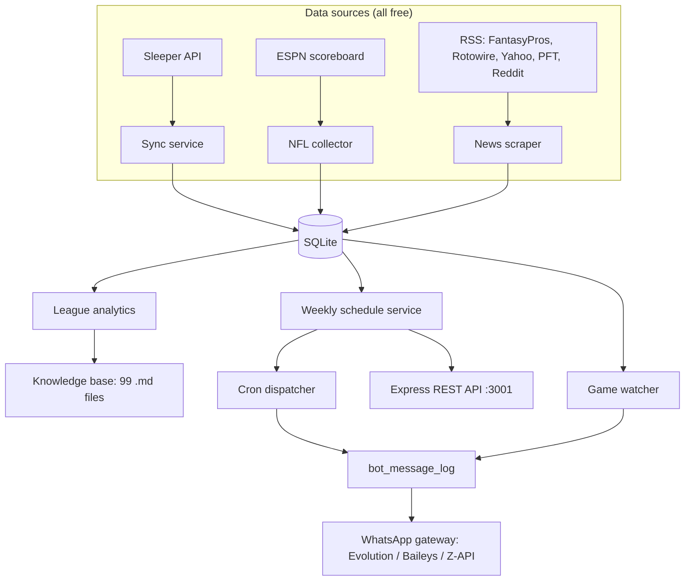

<div align="center">

# 🏈 Sleeper Fantasy Engine + WhatsApp Bot ("Hermes")

### An autonomous data engine, knowledge base and weekly editorial calendar for Sleeper fantasy football leagues

*The first-generation engine behind the league's WhatsApp commentator. Its successor, with an LLM agent and multi-league support, is [mr-irrelevant](https://github.com/pjaragao/mr-irrelevant).*


</div>

---

## What is it?

It turns raw NFL and Sleeper data into entertainment and information for a league's WhatsApp group. **Hermes**, a sarcastic
commentator persona, is fed by a local SQLite database and a **knowledge base of 99 generated Markdown files**, producing
weekly reports, roasts of humiliating losses and praise for winners ("King of the Week" vs "Clown of the Round").

## ✨ Features

- 🤖 **WhatsApp commentator** with a sarcastic personality that analyzes teams and players.
- 📅 **13-slot weekly editorial schedule**, all in Brasília time: Tuesday full recap, Wednesday waiver-wire radar, kickoff-day opening marathon (waivers, standings, H2H matchups, medical report, trash talk), Sunday partials / injury report / warm-up, and a **Red Alert about inactive starters** 90 minutes before kickoff, Monday Night Football special.
- ⚡ **Smart live-game trigger (`GameWatcher`)**: polls the ESPN scoreboard every 2 minutes and fires an instant flash message with the score and league partials the moment any NFL game ends.
- 🕒 **Timezone-proof scheduling**: computed from epoch timestamps so it adapts to the US daylight-saving change.
- 📚 **Autonomous knowledge-base generator**: dossiers on head-to-head history since 2019, biggest blowouts, closest games, rosters and more, ready for LLM agents.
- 💸 **Free to run**: public Sleeper API, ESPN scoreboard and RSS news feeds only.

## 🏗️ Architecture



## 🚀 Getting started

Requires Node.js 18+ and npm 9+.

```bash
git clone https://github.com/pjaragao/Sleeper-API.git && cd Sleeper-API
npm install
cp .env.example .env       # optional: PORT, timezone, SLEEPER_USERNAME
npm run db:migrate         # create tables (Sleeper, NFL, knowledge base, bot log)
npm run sync:players       # download the ~12,000-player NFL catalog
npm run kb:sync            # leagues, matchup history, ESPN games, injury news, projections
npm run kb:generate        # generate the 99 Markdown knowledge-base files
npm run dev                # REST API :3001 + editorial dispatcher (*/5) + game watcher (*/2)
```

| Command | Description |
|---|---|
| `npm run bot:schedule` | print a preview of all 13 editorial slots |
| `npm run bot:triggers` | timezone simulation tests (September vs November vs London) |
| `npm run build` / `npm start` | compile TypeScript / run in production |
| `npm run sync:all` | players, leagues, rosters, matchups and transactions |

---

<div align="center">

Built by **Paulo Aragão Jr** · [GitHub](https://github.com/pjaragao) · [LinkedIn](https://www.linkedin.com/in/paulojrarj)

</div>
